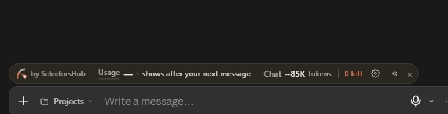

# AI Usage

## Tools

- **Claude** (Anthropic), through the **claude.ai web chat only**. I did not use any CLI-based or agentic coding tool (no Claude Code, Codex, Cursor agent, Copilot agent or similar). Everything went through chat messages and files I copied into my project myself.
- More than one Claude account was used (including one used only for brainstorming). All of them are listed in the token table at the bottom.
- No other AI tool was used.

## The big rule

No AI model is used when the app runs. The categorizer is plain Python rules (see [DESIGN.md](DESIGN.md)). There are no API keys in the project. AI was only used to help me understand the task and to help me write the code and docs.

## How it helped

- Helped me understand `TASK.md` and turn it into a PRD (see "How I worked" below).
- Talked through the use case and what can go wrong on real statements (refunds, transfers, duplicates, sign conventions, messy descriptions).
- Helped design the decision order of the categorizer and the confidence threshold.
- Wrote first drafts of the backend (parser, normalizer, categorizer, API), the tests, and the React frontend.
- Wrote first drafts of the README and DESIGN.md.

## How I worked with it

### The order things happened in

1. **Understand the task, then write a PRD.** I used Claude to help me understand `TASK.md`. Then I had it turn that into a PRD (product requirements document) so the AI knew exactly what to build. The AI then built the project by following that PRD.
2. **Prototype first.** I let the AI build a working prototype quickly (parser, normalizer, categorizer, API, React page, tests). It ran, the tests were green, and the sample statement looked right.
3. **Then I read the code and picked it apart.** I did not want to submit something I could not explain. I went through the code files one by one, and this is where most of the problems below showed up. I did not let the tests decide whether the code was good (see "On AI-written tests"). I judged the code by reading it, by pushing on different files with inputs of my own, and by using the app in the browser to see how it behaves for a real user.
4. **Then I fixed what I found**, one piece at a time, and went back and asked the AI to review its own design critically instead of just adding features.
5. **Then a second, harder review.** I asked the AI to judge the whole project against `TASK.md` and plain common sense, and not to just agree with it. That review found bigger problems than the first (listed below). I also told it to remove anything the task did not need, which cut the saved-rules feature entirely.

### Habits I kept throughout

- **I ran everything myself.** In the earlier build chats Claude never ran anything. I ran every command on my own machine (Windows, PowerShell), tested the app myself, and pasted the output back. I wanted to stay in control of the project and to understand it, not just receive it.
- **I also let Claude run it, to find more problems.** In the later review and cleanup session Claude had a code sandbox and ran things itself: the tests, the inputs written to break the brain, the mutation checks below, and the real server. I also re-ran the tests, lint and build on my own machine and checked the app by hand myself, so I did not rely on Claude's runs.
- **I told it to question its own code, not defend it.** In my prompts I included statements asking it to challenge its own design, say what could be wrong, and disagree with me where needed, instead of supporting what it had already written.
- **One piece at a time, as complete files,** so I could read each one before moving on.
- **When something looked wrong, the AI was asked to read the existing code before suggesting changes.**

## Where the AI got things wrong

All of these were found by reading the code, by trying inputs on purpose, or by using the app in the browser, not by the tests.

1. **A rule that could never match.** `rules.py` had a `CARD PAYMENT` pattern, but the normalizer strips a leading `CARD`, so the pattern could never match. Removed.
2. **Commands for the wrong shell.** It suggested `ls -a`, which does not work in Windows PowerShell.
3. **A dead end in the review flow.** Duplicate flagging was first built with no way for the user to clear a false alarm. Fixed with the `keep_rows` option and a `duplicate_of` field.
4. **The saved-rules feature was a mistake, twice.** While running the app, a random JSON file was being created in the project for no reason I had asked for. Tracing it back showed the AI had built a "remember this merchant forever" feature that the task never asked for (it needed that JSON file, three API endpoints, a UI list and its own tests). The first version could not even be viewed or undone, so one click on Amazon made every future Amazon row automatic. I had the AI add a list and a Remove button. On the second review the real problem showed: rows only reach review because the merchant does *not* decide the category (Amazon, cafes, Uber Eats), so a rule per merchant is wrong for exactly those rows. It also ignored whether money went in or out, so a saved Amazon rule auto-filed an Amazon refund at confidence 1.0. The AI had built a feature, then built a patch for the feature, and neither was needed. **I removed all of it, including the JSON file.** The user now changes a category per row, and nothing is stored.
5. **The user could not fix a wrong answer.** Only Needs Review rows had a dropdown. A row the brain was confidently wrong about was stuck, and the app is built on "a wrong guess is worse than asking". Fixed: every row can be changed, with an Undo.
6. **No way to say "personal" or "other".** The only categories were nine business ones. A personal dinner on a business card could only be filed as Meals, and an unknown merchant had no honest category. Fixed by adding `Personal (not business)` (left out of totals) and `Other Business Expense`.
7. **The sign auto-detect flipped a whole file on a row count.** For an ordinary month with 3 purchases and 4 client payments, the code counted positive rows, decided purchases were positive, and flipped every amount: client payments became unknown expenses and income showed as 0. Only a warning line said so. Now it uses rows from known business merchants as evidence, and when it has none it keeps the signs and says it was a guess. `59.99 CR` and `59.99 DR` used to both read as +59.99 and `1e5` as 15; direction is now read and letters are rejected with a warning.
8. **The brain was confidently wrong, and the AI's design did not allow for that.** The AI gave every rule a fixed confidence (0.95 for ADOBE, HILTON, AUTOPAY and so on) as if a word match meant the row was understood. That number says how good the rule is, not how sure we are about this row. The brain is a word list and cannot know everything, so it should not state wrong answers confidently. Inputs written to trip it:

| Input | Before | Now |
|---|---|---|
| `HILTON GARDEN PIZZA` -30 | Travel, 0.95, auto. "Longest match wins" compared characters, so HILTON beat PIZZA. | Needs Review, names both categories. Any conflict is asked, never decided by length. |
| `AVIS BEAUTY SALON` -60 | Travel, 0.95 | Needs Review. The rule is now `AVIS RENT A CAR`, not the loose word `AVIS`. |
| `AUTOPAY GYM MEMBERSHIP` -30 | Excluded and **left out of the totals**, 0.95 | Needs Review. The rule is `AUTOPAY PAYMENT`. |
| `INVOICE FROM LANDLORD` +2500 | Income, 0.9 | Needs Review. The rule is `INVOICE PAYMENT`. |
| `ZOOM` +5000, `AIRBNB PAYOUT` +900 | Treated as a refund at 0.95, reducing a spending category | Needs Review. Money in from a known merchant is a refund only if the description says refund, return, reversal, credit or chargeback. |
| `GOOGLE*ADS1234567890` | Unknown merchant (the normalizer dropped `ADS1234567890`) | Advertising. A name stuck to a long number keeps the name. |
| `TRANSFER TO SAVINGS ACCOUNT OF BOB` -500 | Excluded, 0.95 | **Still excluded.** The known phrase matches as a prefix. I left it because rejecting every extra word would break real lines like `TRANSFER TO SAVINGS ACCT 1234`. It is listed in DESIGN.md under known limitations. |

   The honest answer is that the brain will still be wrong sometimes. The fixes are to ask when it can see a conflict, and (item 5) to let the user change any row.
9. **A bug in my own fix, caught by the new tests.** While fixing item 7 the AI stripped "currency codes" from amounts with a pattern that matched any three letters, so `12.50 abc` was read as 12.50. A new test for stray letters failed on it. Limited to real currency codes.

### On AI-written tests

The tests were written by the AI, and AI-written tests tend to pass. Claude writes tests to fit the code it just wrote, not to go against it, so of course they were green. Green tests do not mean there are no bugs, so I never let them decide whether something was fine. I decided that by reading the code, by trying my own inputs, and by using the app in the browser.

A test only means something if it can fail. When I read the tests after the prototype, I saw the pattern: **the AI tested what will work if you pass this input, not what can break.** Almost every case was an input the code was built to handle: a clean known merchant (`ADOBE CREATIVE CLOUD`, `STAPLES 00123`), an obviously unknown one (`ZXQV HOLDINGS`), and a tidy refund. The autopay test used `AUTOPAY PAYMENT`, the exact string the rule was written for, and nothing tested `AUTOPAY GYM MEMBERSHIP`. A test written by the author of the code checks the author's assumptions. The first 79 tests were all green while items 5 to 8 above were true.

What it should have asked is "what real input would make this wrong?": a known word inside a different business, a payment method that looks like a merchant, money in that is not a refund, a normal month with more payments in than purchases, an amount with letters in it. The suite now has tests for those (109 in total).

To check the new tests really can fail, I broke the code on purpose and re-ran them: turning off the category-conflict check, treating all money-in as refunds, ignoring the user's choice on duplicates, and going back to counting rows for the sign guess. Each one made tests fail. The first attempt at the conflict check only made one test fail, because the food rule is weak enough to reach review anyway. That meant my conflict tests passed by luck, so I added one with two confident rules that disagree (`ZOOM HILTON CONFERENCE`). Claude also started the real server and called the API with and without fixes against the sample statement.

Not done: there are no frontend tests. The frontend is checked with lint and a build (both in CI), and by hand.

### Manual testing

I ran the backend tests, lint and the frontend build on my own machine, and tried the app in the browser with the sample statement and my own CSV files. Anything I found this way went back into the fixes listed above.

## Token usage

I used the claude.ai web chat only, so it does not show token counts itself. I measured them with the **SelectorsHub token counter browser extension**, which shows an estimated token count for each chat. I did this for **every Claude account I used, including the account used for brainstorming**, and listed each chat below. These are estimates, not exact figures from Anthropic: the extension excludes Claude's system prompt and project files, and a chat's size is not the same as the total tokens processed, because Claude re-reads the whole chat on every message.

Screenshots are in `docs/usage/`.

I used three chats in total, across the Claude accounts mentioned above.

| Chat | Estimated tokens | Screenshot |
|---|---|---|
| Chat 1 | ~51.4K | `chat-token-estimate-1.png` |
| Chat 2 | ~61.2K | `chat-token-estimate-2.png` |
| Chat 3 | ~85K | `chat-token-estimate-3.png` |
| **Total** | **~197.6K from chats 1 and 2, plus chat 3**  |